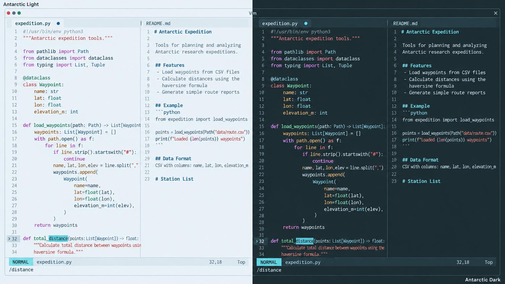

# Antarctic for Vim

Light and dark themes based on the shared [Antarctic palette](https://github.com/AntarcticTheme/.github/blob/main/profile/README.md).



## Requirements

Install [Vim](https://www.vim.org/download.php) 8+ (or gVim).

Use a true-color terminal for accurate colors. 

## Install

```sh
mkdir -p "$HOME/.vim/colors"
curl -fL https://raw.githubusercontent.com/AntarcticTheme/Vim/main/colors/antarctic-light.vim -o "$HOME/.vim/colors/antarctic-light.vim"
curl -fL https://raw.githubusercontent.com/AntarcticTheme/Vim/main/colors/antarctic-dark.vim -o "$HOME/.vim/colors/antarctic-dark.vim"
```

Add to `~/.vimrc`:

```vim
syntax enable
set termguicolors
colorscheme antarctic-dark
```

Use `colorscheme antarctic-light` for light mode. Each variant sets `background` itself. 

Switch at runtime with `:colorscheme antarctic-light` or `:colorscheme antarctic-dark`.

On Windows, create the destination directory if necessary, then download the same files using the GitHub raw-file download button and copy both files into `%USERPROFILE%\vimfiles\colors` and add the settings to `%USERPROFILE%\_vimrc`.

Includes standard syntax groups, status lines, menus, diffs, search, spell checking, and terminal colors. Indexed 256-color fallbacks are included, but true color reproduces the palette accurately.
## Updates

To update, repeat the download/copy steps, then restart the application or reload its configuration.

Released under the MIT license. See [LICENSE](LICENSE).
